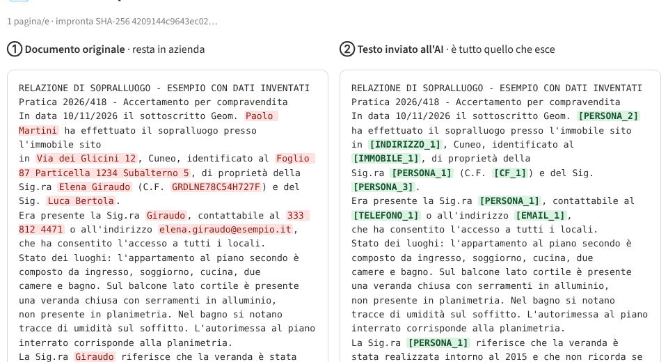

# Documenti immobiliari e AI, senza esporre dati personali

Una demo in Python che, a partire da visure, relazioni di sopralluogo e richieste, **genera la bozza della
relazione di accertamento in Word** usando l'intelligenza artificiale, **senza far uscire dall'azienda nomi,
codici fiscali, indirizzi o contatti**.



> Tutti i dati nei PDF di esempio sono inventati.

## L'idea in cinque punti

1. **Il testo si estrae in locale.** Il PDF non viene mai caricato su servizi esterni.
2. **Non tutto ha bisogno dell'AI.** Le visure catastali hanno un formato fisso. Un parser le legge in locale, verifica il codice fiscale e restituisce intestatari e immobili senza inviare niente a nessuno.
3. **Dove serve l'AI, esce solo testo pseudonimizzato.** Nomi, codici fiscali, IBAN, email, telefoni, indirizzi, identificativi catastali e dati di nascita diventano segnaposto (`[PERSONA_1]`, `[CF_1]`, …). Un nome letto in una visura viene riconosciuto anche nella relazione, scritto in un altro modo o solo con il cognome.
4. **L'AI scrive la bozza, non il documento.** Restituisce oggetto, stato dei luoghi, criticità, verifiche e conclusione, sempre con i segnaposto.
5. **Il documento si compone in locale.** La relazione Word unisce i dati certi della visura (intestatari, dati catastali) e la bozza dell'AI con i dati veri rimessi. L'AI non vede mai il documento finito, e il tecnico rilegge e firma.

**In tutto il flusso** la tabella segnaposto → valore resta in memoria e si svuota a fine lavoro. Un controllo blocca l'invio se nel testo resta qualcosa di riconoscibile. Ogni elaborazione finisce in un registro che non contiene dati personali.

```
PDF ──► testo (locale) ──► visura? ── sì ──► dati strutturati, nessuna AI
                              │
                              no
                              ▼
        pseudonimizzazione ──► controllo uscita ──► AI (bozza) ──► dati veri rimessi
             (locale)              (locale)                            (locale)
                                                                          │
                          relazione .docx ◄── composizione (locale) ◄─────┘
```

## Come si collega al GDPR

| Principio | Nella demo |
|---|---|
| Minimizzazione (art. 5.1.c) | All'AI arriva solo il testo che serve, senza identificativi; le visure non ci arrivano affatto |
| Pseudonimizzazione (art. 4.5, 25, 32) | Segnaposto reversibili solo con il caveau, che non lascia mai il computer |
| Accountability e registro (art. 5.2, 30) | `registro/elaborazioni.jsonl`: cosa, quando, dove, quante sostituzioni, senza contenuti |
| Fornitori esterni (art. 28, capo V) | L'AI è intercambiabile: modello locale (i dati non escono) o fornitore UE con contratto sul trattamento dei dati |

Il codice da solo non basta. In un caso reale servono anche una valutazione d'impatto (DPIA), un contratto con l'eventuale fornitore AI, accessi controllati e tempi di conservazione definiti con il referente privacy.

## Provarla

Servono Python 3.10 o successivo.

```bash
pip install -r requirements.txt
```

**Interfaccia web**

```bash
streamlit run app.py
```

Si apre su http://localhost:8501. Senza file caricati usa i due PDF di esempio. In alternativa puoi caricare i tuoi PDF.

**Riga di comando**

```bash
python -m privacy_ai esempi/visura.pdf esempi/relazione.pdf
```

Stampa ogni passaggio e salva la relazione in `relazione-generata.docx`; nell'interfaccia web c'è il pulsante per scaricarla.

**Test**

```bash
pip install -r requirements-dev.txt && python -m pytest
```

I test verificano che nessun dato personale finisca nel testo inviato o nel registro, che la visura non vada all'AI che la bozza torni con i dati veri e che la relazione Word non contenga segnaposto.

### Con un'AI vera

Di base l'AI è **simulata**: nessuna rete e nessuna chiave. Per usarne una vera basta un servizio con API compatibile OpenAI, da scegliere con l'opzione "API" nell'interfaccia o con `--ai api` da riga di comando.

```bash
# modello in locale con Ollama: i dati non escono dal computer
export PRIVACY_AI_URL=http://localhost:11434/v1
export PRIVACY_AI_MODELLO=llama3.1

# oppure un fornitore con server in UE
export PRIVACY_AI_URL=https://<fornitore>/v1
export PRIVACY_AI_MODELLO=<modello>
export PRIVACY_AI_CHIAVE=<chiave>
```

### Online

L'app si pubblica gratis su [Streamlit Community Cloud](https://streamlit.io/cloud): *New app* → questo repository → file `app.py`.

## Struttura

| File | Cosa fa |
|---|---|
| `privacy_ai/estrazione.py` | Testo e impronta SHA-256 del PDF, con PyMuPDF |
| `privacy_ai/visura.py` | Parser delle visure e controllo del codice fiscale |
| `privacy_ai/pseudonimizza.py` | Riconoscimento dei dati, segnaposto, controllo uscita, reidentificazione |
| `privacy_ai/ai.py` | Bozza della relazione: AI simulata o API compatibile OpenAI (risposta in JSON) |
| `privacy_ai/documento.py` | Composizione della relazione Word con i dati veri |
| `privacy_ai/registro.py` | Registro delle elaborazioni |
| `privacy_ai/flusso.py` | Il flusso completo |
| `app.py` | Interfaccia web (Streamlit) |
| `esempi/genera_esempi.py` | Rigenera i PDF di esempio |
| `esempi/relazione-generata-esempio.docx` | La relazione Word generata dai due esempi |
| `esempi/da-caricare.pdf` | Un terzo documento (richiesta di un avvocato) da caricare nell'interfaccia |

## Limiti noti e prossimi passi

- I nomi si riconoscono con regole del dominio (intestatari, "Sig.ra", "Geom.", …). Per testi molto liberi si può aggiungere un modello NER locale, ad esempio spaCy in italiano. La revisione umana sui casi dubbi resta comunque necessaria.
- I PDF scansionati richiedono un OCR locale come Tesseract prima dell'estrazione.
- Il parser delle visure segue il formato di esempio: con le visure reali va adattato e coperto da test.
